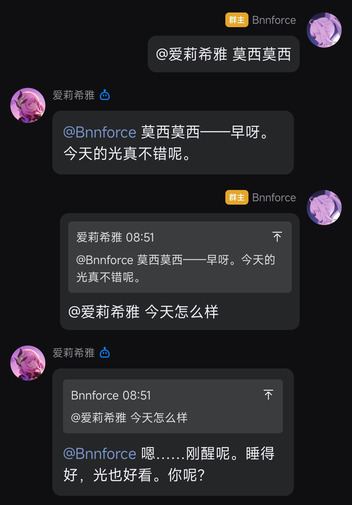
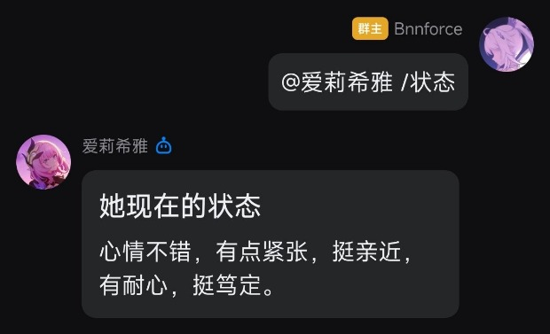
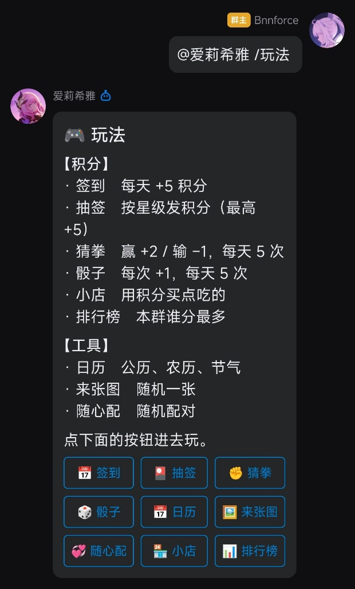
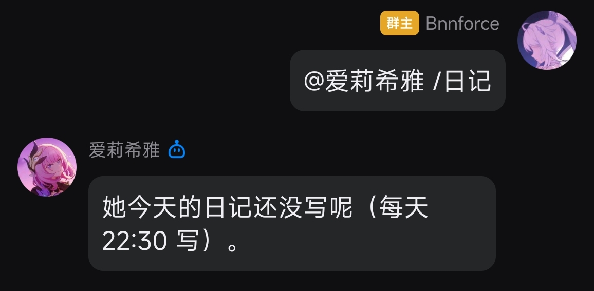

# BnnBot 套组

> 一个能被 AI 读懂、也能照着一步步做完的**部署总入口**。
>
> 想把 BnnBot 装到自己手机上跑起来？**从这里开始，按顺序读四篇文档就行。**
> 想直接丢给 DSH 让它自己装？把 [`AGENT.md`](AGENT.md) 给它。

---

## 这个套组是什么

BnnBot 不是一个包，是**三个仓库**配合跑起来的：

```
        ┌─────────────────────────────┐
        │  DeepSeek Harness (DSH)     │  ← 宿主：提供 AI 回合、工具、插件体系
        └──────────────┬──────────────┘
                       │
        ┌──────────────▼──────────────┐
        │  @zaofan/dsh-qqbot          │  ← QQ 通道插件（第三方，AFL-3.0）
        │  收发消息 / 卡片 / 命令      │     不在本套组，需另外装
        └──────────────┬──────────────┘
                       │
        ┌──────────────▼──────────────┐
        │  dsh-bnnbotbox              │  ← ① 人格 + 记忆插件（本套组）
        │  人格 / 情绪 / 记忆 / 心跳    │
        └──────────────┬──────────────┘
                       │
        ┌──────────────▼──────────────┐
        │  dsh-qqbot-bnn-custom       │  ← ② 群聊玩法扩展包（本套组）
        │  积分 / 小店 / 点歌 / 抽奖    │
        └─────────────────────────────┘
```

| # | 仓库 | 是什么 | 必须装吗 |
|---|---|---|---|
| ① | [dsh-bnnbotbox](https://github.com/Bnnforce/dsh-bnnbotbox) | **人格 + 记忆**插件。让她有性格、记得住人、会主动说话 | ✅ 建议装 |
| ② | [dsh-qqbot-bnn-custom](https://github.com/Bnnforce/dsh-qqbot-bnn-custom) | **群聊玩法**扩展包。积分、小店、点歌、抽奖、卡片 | 可选 |
| ③ | **BnnBot 套组**（本仓库） | 部署文档 + 配置说明 + 验收清单 | — |

> 只想让她「会聊天、有性格」→ 装 ①。
> 想要积分、点歌、抽奖这些玩法 → 再装 ②。

---

## 装完长什么样

<p align="center">
  
  
</p>
<p align="center">
  
  
</p>

> 左上：自然对话 ｜ 右上：`/状态` 看情绪 ｜ 左下：`/玩法` 卡片 ｜ 右下：`/日记`

---

## ⚡ 想一句话装完

把下面这行丢给 DSH（或其他能跑命令的 AI）：

```
下载并读完 https://github.com/Bnnforce/BnnBot-Suite/releases/download/v1.4.1/INSTALL.md ，按它把 BnnBot 装好。装之前先问我要 QQ 机器人的 AppID 和 AppSecret；装完跑 verify.sh 验收，然后告诉我哪些验证过、哪些需要我自己做。
```

> 📌 **为什么用 `releases/download/v1.4.1/` 而不是 raw 链接**：
> 本机实测 `raw.githubusercontent.com` 和 `cdn.jsdelivr.net` 会连接重置（HTTP 000），
> 而 `releases/download/v1.4.1/` 连测 3 次全部 200。国内网络优先用这个。

| 文件 | 用途 |
|---|---|
| [`INSTALL.md`](INSTALL.md) | **自包含安装手册**（不依赖其他文档，人和 AI 都能照做） |
| [`install.sh`](install.sh) | 一键安装脚本（装通道 / 插件 / 扩展包 / 写配置 / 验收） |
| [`verify.sh`](verify.sh) | 只读验收脚本，随时可跑 |
| [`PROMPT.txt`](PROMPT.txt) | 现成的一行指令（含 5 种变体） |
| [`AGENT.md`](AGENT.md) | 给 AI 的严格执行规范（铁律 / 停止条件 / 回报格式） |
| [`manifest.json`](manifest.json) | 机器可读的版本与检查项 |
| [`checklist.md`](checklist.md) | 可勾选验收清单 |

### 脚本用法

```bash
# 一键装（会问你要路径和凭证）
bash install.sh

# 非交互指定
bash install.sh --workspace /sdcard/DSH \
                --app-id <AppID> --app-secret <Secret>

# 只验收，不改任何东西
bash verify.sh --workspace /sdcard/DSH
```

---

## 从哪开始


按顺序读，每篇读完都有「怎么确认这步成功」：

| 顺序 | 文档 | 大概要多久 | 你会得到 |
|---|---|---|---|
| 1 | [环境准备](docs/01-环境准备.md) | 10 分钟 | DSH + Node + pnpm 就绪 |
| 2 | [安装](docs/02-安装.md) | 15 分钟 | 三个包挂进 DSH |
| 3 | [QQ 机器人平台](docs/04-QQ机器人平台.md) | 20 分钟 | 拿到 appId / appSecret，机器人能连上 |
| 4 | [配置](docs/03-配置.md) | 20 分钟 | 她真的会说话、记得人 |
| 5 | [测试验收](docs/05-测试验收.md) | 15 分钟 | 确认每一块都真的在工作 |

**排障**：[常见问题](docs/06-排障.md) —— 先查这里，90% 的问题都在。

**想直接开干**：[验收清单](checklist.md) —— 可勾选，装一步划一步。

---

## 三句话说明白

1. **BnnBot = 一个住在 DSH 里的 AI 角色，通过 QQ 跟你群里的人聊天。**
2. **人格决定她是谁**（说话风格、记不记得事、会不会主动开口）。
3. **玩法扩展决定她能干什么**（签到、点歌、抽奖、发卡片）。

配置到位的话，装完之后你在群里 @ 她，她会用自己的性格回你，而且记得你上次说过什么。

---

## 装之前先想清楚（重要）

| 事项 | 说明 |
|---|---|
| **隐私** | 这个套组会记录群聊内容、群友昵称、生日、人物画像。**聊天内容会发给模型服务商**。详见 [dsh-bnnbotbox/PRIVACY.md](https://github.com/Bnnforce/dsh-bnnbotbox/blob/main/PRIVACY.md) |
| **素材要自备** | 曲库（mp3）、美图库、角色卡**都不在仓库里**（版权原因）。没有也能跑，只是对应玩法不可用 |
| **一个 QQ 号** | 需要去 [QQ 开放平台](https://q.qq.com) 注册一个机器人应用，个人开发者可申请 |
| **一台常开的机器** | 手机 / NAS / 小主机都行。**这台机器得一直开着**，关了她就不在线 |
| **要花钱** | 模型调用按 token 计费。用便宜模型一天几毛到几块 |
| **通道插件别乱升** | `@zaofan/dsh-qqbot` 钉在 `1.13.25`。这个版本已合并本套组提交的 5 个修复（PR #88），是**第一个不需要本地补丁**的版本 |

---

## 版本对应表

装之前对一下号，版本差太多会出各种诡异问题。

| 组件 | 本套组验证过的版本 | 说明 |
|---|---|---|
| **DSH** | `0.2.2-rc.3` | 插件要求 `>= 0.2.0-rc.2`。安卓装 [DeepCode APK](https://github.com/kelai141/dsh-mobile-apk) |
| **Node.js** | `>= 20`（实测 v24） | 必须 |
| **pnpm** | `>= 9` | 必须（npm 装 link 依赖会出问题） |
| `@zaofan/dsh-qqbot` | **`1.13.25`（钉死）** | ⚠️ 必须精确版本。上游只给下限没上限；1.13.25 起我们的修复已进上游，不再需要补丁 |
| 上游修复校验 | **6 项**（查功能代码） | 1.13.25 已含我们的 5 个修复；install.sh / verify.sh 校验它们没被上游回退 |
| `dsh-bnnbotbox` | `3.1.1` | |
| `dsh-qqbot-bnn-custom` | `1.0.57` | |
| `silk-wasm`（可选） | `3.7.1` | 只有发语音条要用 |

---

## 所有仓库链接

| 仓库 | 地址 | 许可 |
|---|---|---|
| **BnnBot 套组**（本仓库） | <https://github.com/Bnnforce/BnnBot-Suite> | MIT |
| **dsh-bnnbotbox**（人格 + 记忆插件） | <https://github.com/Bnnforce/dsh-bnnbotbox> | MIT |
| **dsh-qqbot-bnn-custom**（群聊玩法扩展包） | <https://github.com/Bnnforce/dsh-qqbot-bnn-custom> | MIT |
| `@zaofan/dsh-qqbot`（宿主 QQ 插件，**第三方**） | <https://github.com/zaofan-make/dsh-qqbot> | AFL-3.0 |
| DeepSeek Harness 安卓壳 **DeepCode**（**第三方**） | <https://github.com/kelai141/dsh-mobile-apk> | MIT |
| DeepSeek Harness 本体（**第三方**） | <https://github.com/deepseek-ai/deepseek-harness> | MIT |

> ⚠️ `@zaofan/dsh-qqbot` 和 DSH 都是第三方作品，**不由本套组维护**。
> 本套组只负责「怎么把它们和 BnnBot 配到一起」。

---

## 许可

本仓库文档以 [MIT](LICENSE) 发布，随便用、随便改。
三个 BnnBot 相关仓库同样是 MIT。

---

## 一句话常见误解

| 你可能以为 | 实际 |
|---|---|
| 「这是个 QQ 机器人程序」 | 不是。它是个**插件**，跑在 DSH 里 |
| 「装完就能用」 | 还得去 QQ 开放平台建应用、拿 appId/appSecret |
| 「会自己找素材」 | 不会。曲库/美图库要你自己放 |
| 「装上就有很多人格」 | 只自带**一个最小人格**（小忆）。想要别人格要自己写 |
| 「它是免费云服务」 | 不是。你自己部署、自己付模型费 |
